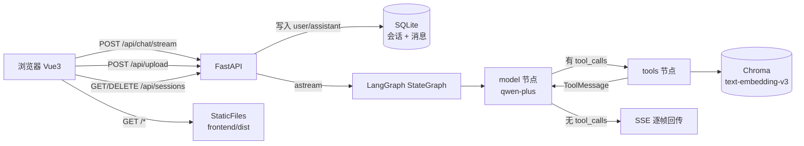

# AI 个人知识库助手

上传 PDF → 自动切块向量化 → 基于 RAG 的文档问答。带 Agent 工具调用、SSE 流式输出、多会话记忆与来源页码标注。

## 架构



## 功能

- [x] PDF 上传 + 自动切块 + 向量化入库（按文件名去重、大小上限、不留孤儿文件）
- [x] 基于 RAG 的文档问答，**回答标注来源文件名 + 页码**
- [x] SSE 流式输出（逐字返回），支持中途停止
- [x] 多会话管理（会话隔离 + 历史持久化 + 删除）
- [x] Agent 工具调用（知识库检索 / 计算器 / 当前时间，由模型自主决策）
- [x] 进程内 IP 限流（保护 LLM 额度）
- [x] Docker 一键部署（单容器，页面与接口同源）

## 接口

| 方法   | 路径                 | 说明                                                |
| ------ | -------------------- | --------------------------------------------------- |
| POST   | `/api/chat/stream`   | SSE 流式对话（`event: message` / `done` / `error`） |
| POST   | `/api/upload`        | 上传 PDF 并入库，返回 `pages` / `chunks`            |
| GET    | `/api/sessions`      | 会话列表（标题 / 时间 / 消息数）                    |
| GET    | `/api/sessions/{id}` | 某会话全部消息（不存在返回 `[]`，不返回 404）       |
| DELETE | `/api/sessions/{id}` | 删除会话及其消息                                    |
| GET    | `/health`            | 健康检查                                            |

## 工程质量（可复现的实测结论）

完整踩坑记录与面试问答（ 23 条）见私有文档；下面只列可复现的部分，均来自 `scripts/verify_*.py` 与真实 HTTP 调用：

| 事项           | 实测结果                                                                                                                |
| -------------- | ----------------------------------------------------------------------------------------------------------------------- |
| 不阻塞事件循环 | 心跳探针 A/B 对照：`asyncio.to_thread` 组心跳最大间隔 **76~80ms** vs 同步直调组 **2062~2420ms**（阈值 150ms，差 27 倍） |
| RAG 阈值标定   | 正样本最大距离 **0.46** / 负样本最小 **1.16**，间隔 **0.69**（当前取 0.7，偏严、存在漏收）                              |
| 工具路由双向   | 该调用 **3/3** 命中；不该调用 **0/3** 误触发                                                                            |
| 中断收尾       | 客户端断开后仍落库 `user` + `assistant` 成对，尾部 `…（已中断）`，服务端无 traceback                                    |
| 入库去重       | 同一文件重复上传，chunk 数 **15 → 15**（不翻倍）                                                                        |

## 技术栈

| 层     | 技术                                                    |
| ------ | ------------------------------------------------------- |
| 前端   | Vue3 + Vite                                             |
| 后端   | Python 3.14 + FastAPI                                   |
| AI     | LangChain + LangGraph + DashScope（通义千问 qwen-plus） |
| 向量库 | Chroma（Embedding：text-embedding-v3）                  |
| 存储   | SQLite                                                  |
| 运行   | 本地直接跑，或用 Docker 一键启动                        |

## 目录结构

```text
ai-knowledge-assistant/
├── backend/
│   ├── main.py            # 入口：路由挂载 + 静态站托管 + 启动校验
│   ├── config.py          # 路径与参数集中配置
│   ├── database.py        # SQLite：会话与消息
│   ├── ratelimit.py       # 进程内 IP 限流
│   ├── ai/                # llm / vectorstore / ingest / agent / tools
│   └── api/               # chat（SSE）/ upload / sessions
├── frontend/              # Vue3 + Vite
├── Dockerfile             # 多阶段构建：node 编译前端 → python 运行时
├── docker-compose.yml     # 一条命令启动（含数据目录挂载）
├── .env.example
└── requirements.txt
```

## 本地运行

```powershell
# 1. 虚拟环境 + 依赖
python -m venv .venv
.venv\Scripts\activate
pip install -r requirements.txt

# 2. 配置 Key
copy .env.example .env      # 填入 DASHSCOPE_API_KEY

# 3. 起后端（必须从项目根目录启动）
.venv\Scripts\python.exe -m uvicorn backend.main:app --reload --port 8000

# 4. 起前端（另开一个终端）
cd frontend
npm install
npm run dev                 # 访问 http://localhost:5173
```

后端接口文档：`http://127.0.0.1:8000/docs`

> 前端未构建时（无 `frontend/dist`），后端会跳过静态站挂载，接口照常可用。

## 用 Docker 运行

不想装 Python 和 Node 环境的话，容器里已包含全部依赖：

```bash
cp .env.example .env    # 填入 DASHSCOPE_API_KEY
docker compose up -d --build
# 访问 http://127.0.0.1:8000 —— 页面与接口同源，没有跨域也没有代理
```

`docker-compose.yml` 把 `./data` 挂载到宿主机，所以会话记录、向量库、上传的 PDF 都会保留。
